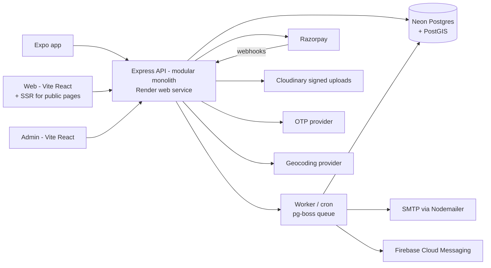
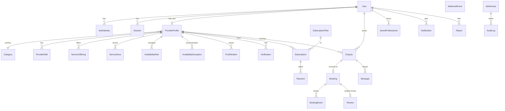

# Technical & Design Proposal (pre-Phase 1)

Status: **awaiting owner approval**. Nothing in this repo is implemented yet. The open decisions in §11 need answers before Phase 1 starts.

---

## 1. PRD understanding

The product is a two-sided marketplace. Providers build a LinkedIn-style profile and pay a subscription to be discoverable. Customers search nearby for free, then enquire or book and leave verified reviews. There is one account and one backend for mobile, web and admin.

**MVP (Phases 1–8):** auth (Google + OTP), provider onboarding and drafts, Razorpay subscriptions, location discovery and filters, enquiries and bookings with a state machine, messaging, verified reviews, verification levels, admin core modules, email and push.
**Later (Phase 9+):** sponsored/promoted listings (admin module only, kept in the schema), business teams, AI or voice search, referrals, web push.

**Gaps and conflicts I found, with proposed resolutions:**
| # | Gap | Proposal |
|---|-----|----------|
| G1 | SEO public profiles vs. a plain Vite SPA | Keep Vite. Add a small SSR or prerender step for public routes only (`/`, `/professionals/:slug`, `/c/:category/:city`). See D3. |
| G2 | The "OTP provider" isn't named. Indian SMS needs DLT template registration. | Choose MSG91 or Firebase Phone Auth (D2). |
| G3 | Maps provider not named | Google Maps vs. Ola Maps / Mappls (D4). |
| G4 | Can a provider receive enquiries from existing customers after their subscription expires? | New marketplace enquiries are blocked. Threads and confirmed bookings stay open. |
| G5 | Review eligibility window | Review allowed for 30 days after COMPLETED. Editable for 48 h. |
| G6 | Who marks a booking complete? | The provider marks it complete and the customer confirms. It auto-confirms after 72 h unless the customer disputes. |
| G7 | Refund policy is undefined | No pro-rata refunds. Cancelling stops renewal and access lasts until the paid-through date. Needs owner/legal sign-off. |
| G8 | How the profile slug handles name collisions | `name-profession-city`, with a short suffix on collision. Old slugs 301-redirect to the new one. |
| G9 | Messaging transport | MVP: REST + short polling / SSE. WebSockets later if needed. |
| G10 | Languages | English UI first, with an i18n framework from day 1. Add Hindi + one regional language once the launch city is chosen. |
| G11 | DPDP | Consent records, data export and delete endpoints, and a grievance officer contact on the website. |

## 2. Architecture



- **Auth:** our own JWTs. Short-lived access token (15 min) plus a rotating refresh token, stored hashed in a `Session` row per device. That row enables "log out this device" and detects token reuse. Google ID tokens and OTPs are verified server-side. Identities are linked by verified email or phone.
- **Jobs:** pg-boss (a Postgres-backed queue) instead of Redis. One less paid service at launch. It handles email/push sending, the grace-period expiry sweep, availability reminders and Razorpay reconciliation.
- **Geo:** PostGIS `geography(Point)` with a GiST index. Prisma models it as `Unsupported`, and proximity queries go through one typed raw-SQL repository.
- **Payments:** Razorpay Plans are mirrored from an admin-editable `SubscriptionPlan` table. Checkout returns a signature, which the backend verifies (status becomes PENDING). Only the `subscription.activated` / `charged` webhook sets ACTIVE. Every event is stored by event id, so redelivery is a no-op.

## 3. Monorepo
```
apps/mobile        Expo (expo-router), customer + provider modes
apps/web           Vite React; public SSR entry + SPA dashboards
apps/admin         Vite React admin
services/api       Express; src/modules/<domain>/{routes,service,repo,schemas}
packages/types     shared TS types (inferred from Zod)
packages/validation Zod schemas = API contract
packages/domain    pure business rules: booking & subscription state machines, ranking, eligibility
packages/api-client typed fetch client used by all 3 apps
packages/ui-tokens  design tokens (colors, spacing, type) for web + RN
packages/config     tsconfig, eslint, prettier
infrastructure/database  prisma schema, migrations, seeds
docs               PRD, proposal, decisions, API, deployment, checklist
```
One addition beyond the PRD: `packages/domain`. It holds the state machines and rules so mobile, web and API never re-implement them. `packages/ui-tokens` keeps web and mobile visually consistent.

## 4. Database (core entities)

Key constraints and indexes:
- `AuthIdentity(provider, providerUserId)` unique.
- `User.email` / `User.phone` unique where not null.
- `ProviderProfile.slug` unique, plus a GiST index on `location` and a btree on `(status, isDiscoverable, categoryId)`.
- A trigram index on name/title/skills for search.
- `Review.bookingId` unique, so there is one review per booking.
- `WebhookEvent.eventId` unique.
- At most one live subscription per provider, enforced by a partial unique index where status is in (PENDING, ACTIVE, PAST_DUE).
- Soft-delete (`deletedAt`) on users, profiles and portfolio items.
- Payments and subscriptions are append-only history.

**Booking states:** `REQUESTED → (ACCEPTED | DECLINED | RESCHEDULE_PROPOSED | EXPIRED)`, `RESCHEDULE_PROPOSED → (ACCEPTED | DECLINED)`, `ACCEPTED → (IN_PROGRESS | CANCELLED_BY_CUSTOMER | CANCELLED_BY_PROVIDER)`, `IN_PROGRESS → COMPLETED_PENDING_CONFIRMATION → (COMPLETED | DISPUTED)`. Transitions are checked in `packages/domain` and applied in a DB transaction with optimistic versioning.

## 5. API modules
`/api/v1/` auth · users · providers (profile, onboarding steps, publish) · categories · services · discovery (search, nearby, ranking) · availability · subscriptions · payments (+ `/webhooks/razorpay`, raw body) · enquiries · bookings · messages · reviews · notifications · media (signed upload) · reports · admin/*.

Standard across the API:
- Response envelope `{data, error:{code,message,details}, meta:{page,...}}`.
- Cursor pagination.
- Rate limiting (stricter on auth/OTP).
- OpenAPI docs generated from the Zod schemas.

## 6. UI/UX plan
**Design system:** PRD palette and Inter. Lucide icons. 8px spacing grid. Corner radius 12 on cards and 16 on sheets. Two shadow levels only. Teal is reserved for primary actions and verified badges, so it stays meaningful.
Components: Button, Input, Select, Chip/FilterChip, Card, ProviderCard, RatingStars, VerificationBadge (identity and qualification shown as distinct icons), Avatar, Sheet/Modal, Tabs, EmptyState, Skeleton, Toast, StatusPill (booking and subscription), Stepper (onboarding), MapPreview, DistanceSlider, AvailabilityGrid.

**Mode switch:** one account with a "Switch to Provider/Customer mode" control in the Profile tab and the web header. Each mode has its own tab bar (PRD §20). A provider with a draft profile sees a persistent "Finish your profile" banner.

**Screen inventory**
- *Customer (mobile + web):* Splash/Welcome, Login (Google/OTP), OTP verify, Location picker, Home, Search results (list + map toggle), Filters sheet, Category page, Provider profile, Gallery viewer, Enquiry/Booking request, Booking detail + timeline, Bookings list, Messages list, Chat, Saved, Write review, Notifications, Profile/Settings, Report provider, Help/Safety.
- *Provider (mobile + web dashboard):* Onboarding stepper (8 steps), Profile preview, Plans & checkout, Payment result, Dashboard (stats), Enquiries inbox, Enquiry detail (accept/decline/propose time), Bookings calendar/list, Services & pricing editor, Availability editor, Portfolio manager, Verification upload, Subscription & billing history, Reviews (reply), Settings.
- *Web-only public:* Landing, City+category SEO pages, Public profile (SSR), Pricing for providers, Legal (terms, privacy, refund, grievance).
- *Admin:* Login, Overview, Users, Providers (detail + actions), Categories/skills, Verification queue, Plans, Subscriptions, Payments/reconciliation, Bookings, Review moderation, Reports & disputes, Promotions, Analytics, Audit log, Admin roles.
Every screen gets loading (skeleton), empty, error (retry) and success states. Web breakpoints are 360/768/1024/1440. Mobile is tested at small Android (360×640), standard, large, and iPhone SE/15/Pro Max sizes.

## 7. Roadmap (each phase ends with tests, docs and owner sign-off)
| Phase | Key tasks | Done when |
|---|---|---|
| 1 Foundation | monorepo, tooling, Prisma schema v1 + Neon, API skeleton (errors, logging, envelope), auth (Google, OTP, sessions, linking), web/mobile/admin shells with login | Same user logs in on web + mobile; auth tests pass |
| 2 Profiles | categories seed, onboarding steps, drafts, Cloudinary uploads, slug, preview | Provider completes onboarding and previews profile |
| 3 Subscriptions | plans, Razorpay sub create, checkout web+mobile, signature verify, webhooks, grace/expiry jobs, cancel, history, emails | Test-mode payment publishes the profile; duplicate and delayed webhook tests pass |
| 4 Discovery | geocoding, PostGIS search, filters, ranking, list/map, SSR public profile | Customer finds nearby active providers; inactive ones are hidden |
| 5 Bookings | enquiries, booking state machine, messaging, notifications (FCM + email) | Full enquiry→complete flow on both platforms |
| 6 Trust | verified reviews, replies, reports, verification queue | Only completed bookings can review |
| 7 Admin | all §19 modules + RBAC + audit log | Admin manages marketplace |
| 8 QA/Launch | e2e (Playwright web, Maestro mobile), security pass, load test search, Render prod, monitoring (Sentry), backups | §30 criteria met |

## 8. Risks
- **Technical:** Prisma lacks native PostGIS support, so I'll use a raw-SQL repo with tests. Render free instances cold-start, so production must be on a paid plan. Expo builds need EAS. Razorpay subscription UPI-autopay limits and mandate failures.
- **Financial:** SMS OTP cost per login, which I'll reduce with long refresh sessions and Google as the default. Maps API costs, reduced by caching geocodes and using a static map image on cards.
- **Operational:** DLT registration and Razorpay KYC take days or weeks, so start them now. Verification needs manual admin review.
- **Security:** IDOR across bookings/messages (resource-ownership middleware plus tests), webhook spoofing, contact scraping (rate limits, masked contact until enquiry).
- **Product:** cold start, subscription resistance (consider a first-month intro offer), disintermediation.

## 9. Cost (launch scale; check current pricing pages before committing)
| Service | Launch tier | Notes |
|---|---|---|
| Neon | Free → Launch plan | Free tier is fine for dev/staging; paid plan for prod storage/compute and PITR |
| Render | Starter web service (+ cron) | Free tier sleeps, so it's unsuitable for prod and webhooks |
| Cloudinary | Free | Credit-based; upgrade when media grows |
| Razorpay | No fixed fee | Per-transaction fee on each charge |
| SMS OTP | Pay per SMS | Needs DLT; the biggest variable cost |
| Maps/geocoding | Free credit, then per call | Cache aggressively |
| FCM | Free | |
| SMTP | e.g. Brevo/SES/Zoho | Free or low tiers for transactional email |
| Expo EAS | Free tier | Paid if build queue time matters |
| Apple dev | ~$99/yr; Google Play one-time ~$25 | Required to publish |

## 10. Model and usage strategy
See the response in chat. It is summarised in `CLAUDE.md` → "Model usage".

## 11. Decisions needing owner approval
- **D1** Approve the stack as written, plus the additions `packages/domain`, `packages/ui-tokens`, pg-boss and our own JWT sessions.
- **D2** OTP provider: MSG91 (cheapest in India, needs DLT) vs. Firebase Phone Auth (faster setup, higher per-SMS cost at scale).
- **D3** SEO: Vite + SSR for public routes only (recommended) vs. switching web to Next.js.
- **D4** Maps: Google Maps Platform vs. Ola Maps / Mappls.
- **D5** Launch city (drives seed data, language and timezone defaults).
- **D6** Refund and completion policies G5–G7.
- **D7** Brand name and domain. The repo is `help-app`; is that the product name?
